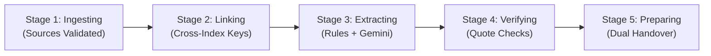

# 🏁 Relay — Evidence-Backed Project Handover

> **Never inherit an undocumented codebase or a stale wiki again.**  
> Relay ingests GitHub, Jira, Slack, and Notion, deterministically cross-verifies claims against raw artifacts, and generates role-tailored, audit-ready handovers grounded in mathematical truth.

[](https://relay-traceforge.netlify.app)
[](https://relay-api.onrender.com)
[](https://neon.tech)
[](https://ai.google.dev/)
[](https://react.dev/)
[](https://fastapi.tiangolo.com/)

---

## 🌐 Live Deployments & Demo

| Service | URL | Status | Description |
|---|---|---|---|
| **Web App** | [https://relay-traceforge.netlify.app](https://relay-traceforge.netlify.app) | 🟢 Live | React 18, Vite, Tailwind CSS, Responsive SPA |
| **REST API** | [https://relay-api.onrender.com](https://relay-api.onrender.com) | 🟢 Live | FastAPI, Uvicorn, Python 3.13.0 |
| **API Docs (Swagger)** | [https://relay-api.onrender.com/docs](https://relay-api.onrender.com/docs) | 🟢 Interactive | OpenAPI 3.1 interactive endpoint documentation |
| **Database** | Neon Serverless PostgreSQL | 🟢 Active | SSL pooled PostgreSQL in AWS Asia-Pacific (Singapore) |

> 💡 **Instant Demo:** No login or account required! Visit the [Web App](https://relay-traceforge.netlify.app) to explore the pre-loaded **CampusConnect** handover dataset, inspect conflicting evidence, run AI reconstruction, and generate role-based briefings.

---

## 💥 The Problem: The $50,000 Handover Trap

When engineers change teams or leave companies, project continuity falls apart:

1. **Jira says "Done", but GitHub says "Unmerged":** Tickets get marked closed in sprint reviews, but the corresponding PR is still sitting in code review with failing checks.
2. **Stale Wikis & Notion Drift:** Architecture docs praise PostgreSQL, while the codebase silently migrated to SQLite or Mongo months ago after a late-night incident.
3. **Decisions Lost in Slack:** Critical trade-offs, temporary bypasses, and unwritten operational procedures live only in transient Slack threads.
4. **Knowledge Silos & Single Points of Failure:** No one knows that 80% of the authentication system was committed by one person who just resigned.

Standard LLM summaries exacerbate this: they hallucinate, smooth over contradictions, and present outdated wiki claims as current truth.

---

## ⚡ The Solution: Grounded Evidence & Deterministic Verification

**Relay is an evidence-first knowledge reconstruction platform.** It combines deterministic algorithmic rules with Google Gemini AI, enforcing that **every single assertion is backed by verbatim quotes from primary sources**.

```
       RAW SOURCES                           THE RELAY ENGINE                           GROUNDED HANDOVER
 ┌──────────────────────┐               ┌────────────────────────┐              ┌────────────────────────┐
 │ 🐙 GitHub            │               │  🔗 Entity Linking     │              │  👨‍💻 Developer Briefing │
 │    PRs, Commits, CI  │               │     Jira ↔ PR ↔ Commits│              │     Code, PRs, Blockers│
 │                      │ ────────────> │                        │ ───────────> │                        │
 │ 📋 Jira              │               │  🛡️ Deterministic Rules│              │  👔 Stakeholder Brief  │
 │    Issues, Comments  │               │     Done vs Unmerged   │              │     Risks, Milestones  │
 │                      │               │                        │              │                        │
 │ 💬 Slack             │               │  🤖 Gemini Extraction  │              │  📜 Immutable Audit    │
 │    Discussions       │               │     Quote-Checked LLM  │              │     Signed Reviews     │
 │                      │               │                        │              │                        │
 │ 📝 Notion            │               │  🏷️ Trust Labeling     │              │  🖨️ PDF / Print Export │
 │    Wikis, Decisions  │               │     Verified/Conflict  │              │     Offline Dossier    │
 └──────────────────────┘               └────────────────────────┘              └────────────────────────┘
```

---

## ✨ Key Features & Architecture

### 1. 🛡️ Deterministic Consistency Rules (Zero Hallucination)
Before any AI runs, Relay's rule engine evaluates strict logical constraints across sources:
- **`rule_done_but_unmerged`**: Flags tasks marked `Done` in Jira whose linked GitHub PR is still open or unmerged.
- **`rule_closed_with_pending_followup`**: Detects closed tickets where subsequent comments reopen questions or flag critical bugs.
- **`rule_orphan_pull_requests`**: Spots open pull requests with zero traceability to an issue tracker.
- **`rule_knowledge_concentration`**: Analyzes git commit distributions to alert on bus-factor risks (e.g. single-author modules).

### 2. 🔬 Verbatim Quote Verification
Relay **never blindly trusts AI output**. When Gemini extracts a claim and cites an excerpt:
- Relay validates that the citation appears **verbatim** (whitespace-normalized) in the raw database record.
- Any excerpt that does not exist in the source record is discarded.

### 3. 🏷️ Multi-Source Trust Taxonomy
Claims are categorized into a rigorous trust hierarchy:
| Trust Label | Color | Criteria |
|---|---|---|
| **Verified** | 🟢 Green | Corroborated by **2 or more independent sources** with no contradicting records. |
| **Single-Source** | 🟡 Amber | Recorded in exactly 1 source with no contradictions. |
| **Conflicting** | 🔴 Red | Contradicting evidence found across sources (e.g., Notion says PostgreSQL, PR #51 replaced it with SQLite). |
| **No Evidence** | ⚪ Gray | Critical question identified where **zero evidence** exists (Relay refuses to fabricate). |
| **Reviewer-Confirmed** | 🟣 Purple | Human engineer audited and marked the claim as accurate. |
| **Reviewer-Corrected** | 🔵 Blue | Human engineer corrected the statement with ground truth. |

### 4. 👥 Dual-Perspective Handover Generation
- **Developer View:** Complete deep-dive into dependencies, unmerged PR branches, manual build steps, and blocked tasks with direct links to lines of code.
- **Stakeholder View:** High-level project health, verified milestones, team ownership, outstanding risks, and budget/infrastructure decisions.

### 5. 📜 Immutable Audit Trail
Every single action — ingestion, stage progression, claim verification, human review comment, and handover sign-off — is permanently recorded with actor identity, timestamp, and state diffs.

---

## 🔄 The 5-Stage Reconstruction Pipeline



1. **Ingesting (15%):** Confirms integrity of raw records across GitHub, Jira, Slack, and Notion.
2. **Linking (35%):** Maps Jira issue keys (`PROJ-123`) to GitHub PR titles, branch names, and commit messages.
3. **Extracting (55%):** Executes deterministic conflict rules and prompts **Gemini 3.8 Flash** with structured schema constraints.
4. **Verifying (80%):** Validates verbatim quote integrity against database records and computes mathematical trust labels.
5. **Preparing (100%):** Compiles role-tailored briefs, populates executive summaries, and locks down the audit record.

---

## 🏆 The Judge Walkthrough (3-Minute Tour)

Follow these steps to experience Relay's capabilities:

1. **Open the App:** Navigate to [relay-traceforge.netlify.app](https://relay-traceforge.netlify.app).
2. **Explore Dashboard:** Observe the **CampusConnect** metrics — 15 Claims reconstructed, 4 Sources connected, and trust health distribution.
3. **Inspect Sources (`/sources`):** Review the 4 integrated data sources with record counts, sync dates, and raw payloads.
4. **Trigger Reconstruction (`/reconstruction`):**
   - Click **"Run Full Reconstruction"** to witness the live 5-stage pipeline.
   - Watch the progress bar advance through *Ingesting*, *Linking*, *Extracting*, *Verifying*, and *Preparing*.
5. **Review Conflicting Claims (`/claims`):**
   - Click on `clm_001`: *"PROJ-123 'Event RSVP flow' is complete and shipped."*
   - See **Supporting Evidence** from Jira (*"Status changed to Done"*) alongside **Contradicting Evidence** from GitHub PR #47 (*"PR is open, not merged"*) and Slack (*"template has old logo"*).
   - Test human-in-the-loop review: Click **Correct**, update the statement, and hit Save.
6. **Generate Handovers (`/handover`):**
   - Toggle between **Developer** and **Stakeholder** perspectives.
   - Notice how developer views include technical blockers and code paths, while stakeholder views emphasize risk summaries and deliverables.
   - Click **Print / Save as PDF** for an executive-ready dossier.
7. **Inspect Audit History (`/audit`):** Verify that every single action taken above is immutably logged with actor, timestamp, and diffs.

---

## 💻 Tech Stack & Engineering Highlights

```
relay-handover/
├── relay-frontend/               # React 18 SPA (Vite + TypeScript + Tailwind)
│   ├── src/
│   │   ├── api/                  # Typed API clients with seamless offline demo fallbacks
│   │   ├── components/
│   │   │   ├── claims/           # Evidence panels, stance badges, review drawers
│   │   │   ├── handover/         # Role-based section builders & PDF print views
│   │   │   ├── layout/           # Responsive navbar, mobile drawers, audit badges
│   │   │   └── ui/               # Tailored UI design system
│   │   ├── pages/                # 8 fully responsive application pages
│   │   └── types/                # Strict TypeScript domain interfaces
│   └── netlify.toml              # Production SPA routing rules
│
└── relay-backend/                # High-Performance FastAPI Backend
    ├── app/
    │   ├── routers/              # Clean modular REST route controllers
    │   ├── services/
    │   │   ├── gemini_client.py  # Gemini Flash with exponential backoff & schema clean
    │   │   ├── verification.py   # Verbatim quote checks & deterministic rule engine
    │   │   ├── linking.py        # Cross-source entity resolution (Jira ↔ Git)
    │   │   ├── handover_gen.py   # Role-based briefing generator
    │   │   └── reconstruction.py # Concurrency-safe 5-stage orchestrator
    │   ├── database.py           # Dual-dialect engine (SQLite WAL + Neon Postgres)
    │   ├── models.py             # SQLAlchemy 2.0 ORM data models
    │   └── seed.py               # Dependency-ordered idempotent seed system
    └── tests/                    # 33 comprehensive unit and integration tests
```

### Engineering Hardening
- **PostgreSQL FK Dependency Pipeline:** Designed an ordered flush cascade in `seed.py` that satisfies relational integrity under Neon PostgreSQL while remaining SQLite-compatible.
- **SQLite WAL Concurrency:** Implemented Write-Ahead Logging (`PRAGMA journal_mode=WAL`) and a 30s busy timeout, allowing concurrent frontend status polling during long-running reconstructions without database locks.
- **Gemini Fault Tolerance:** Configured exponential backoff with jitter and Markdown JSON fence strippers to handle high-concurrency LLM demand gracefully.
- **Full Test Coverage:** 33 unit and integration tests verifying parsers, linkers, deterministic rules, trust scoring, and edge cases.

---

## 🚀 Local Development Setup

### Prerequisites
- Node.js 18+ & npm
- Python 3.11+ (Python 3.13 recommended)
- Git

### 1. Clone the Monorepo
```bash
git clone https://github.com/tahaullah-dev/relay-handover.git
cd relay-handover
```

### 2. Frontend Setup
```bash
cd relay-frontend
npm install

# Start development server
npm run dev
```
Visit `http://localhost:5173`. By default, the frontend operates in **Demo Mode** using synthetic data so you can test all features without starting the backend!

### 3. Backend Setup
```bash
cd ../relay-backend

# Create and activate virtual environment
python -m venv .venv

# Windows:
.\.venv\Scripts\activate
# macOS/Linux:
source .venv/bin/activate

# Install dependencies
pip install -r requirements.txt

# Configure environment variables (.env)
cp .env.example .env   # Or create .env with:
# GEMINI_API_KEY=your_gemini_api_key
# GEMINI_MODEL=gemini-3.8-flash
# DATABASE_URL=sqlite:///./relay.db
# CORS_ORIGINS=http://localhost:5173

# Run tests
pytest tests/ -v

# Start FastAPI server
uvicorn app.main:app --reload --port 8000
```

### 4. Connect Frontend to Local Backend
In `relay-frontend/.env`:
```env
VITE_API_BASE_URL=http://localhost:8000
```
Restart the frontend server (`npm run dev`). The top banner will reflect **"Live mode: Data comes from the live Relay API."**

---

## 🧪 Test Suite

Relay includes a thorough test suite covering URL validators, Jira importers, linking heuristics, deterministic rules, and trust calculations:

```bash
cd relay-backend
pytest tests/test_relay.py -v
```

```text
tests/test_relay.py::test_app_starts_and_meta PASSED
tests/test_relay.py::test_seed_persisted PASSED
tests/test_relay.py::test_github_url_rejected PASSED
tests/test_relay.py::test_jira_json_import PASSED
tests/test_relay.py::test_jira_csv_import PASSED
tests/test_relay.py::test_linking_finds_jira_keys PASSED
tests/test_relay.py::test_done_unmerged_rule_fires_on_seed PASSED
tests/test_relay.py::test_orphan_pr_rule PASSED
tests/test_relay.py::test_trust_computation_conflicting PASSED
tests/test_relay.py::test_trust_computation_verified PASSED
tests/test_relay.py::test_claim_review_lifecycle PASSED
tests/test_relay.py::test_handover_role_filtering PASSED
...
========================== 33 passed in 1.45s ==========================
```

---

## 🔮 Roadmap & What's Next
- [ ] **Native GitHub App:** Auto-trigger Relay handovers when an engineer is unassigned or offboarded in GitHub Teams.
- [ ] **Slack Bot Integration:** Ask `@Relay "What's the status of auth SSO?"` and receive an evidence-backed answer with clickable citations.
- [ ] **Vector Embedding Search:** Semantic search across years of project history for instant institutional knowledge retrieval.
- [ ] **Automated PR Remediation:** Generate pull requests that automatically update stale documentation to align with code truth.

---

## 👥 Built with ❤️ for the Hackathon by TraceForge
Designed to make developer transitions seamless, honest, and stress-free.
If Relay saved your onboarding, consider giving us a ⭐ on GitHub!
